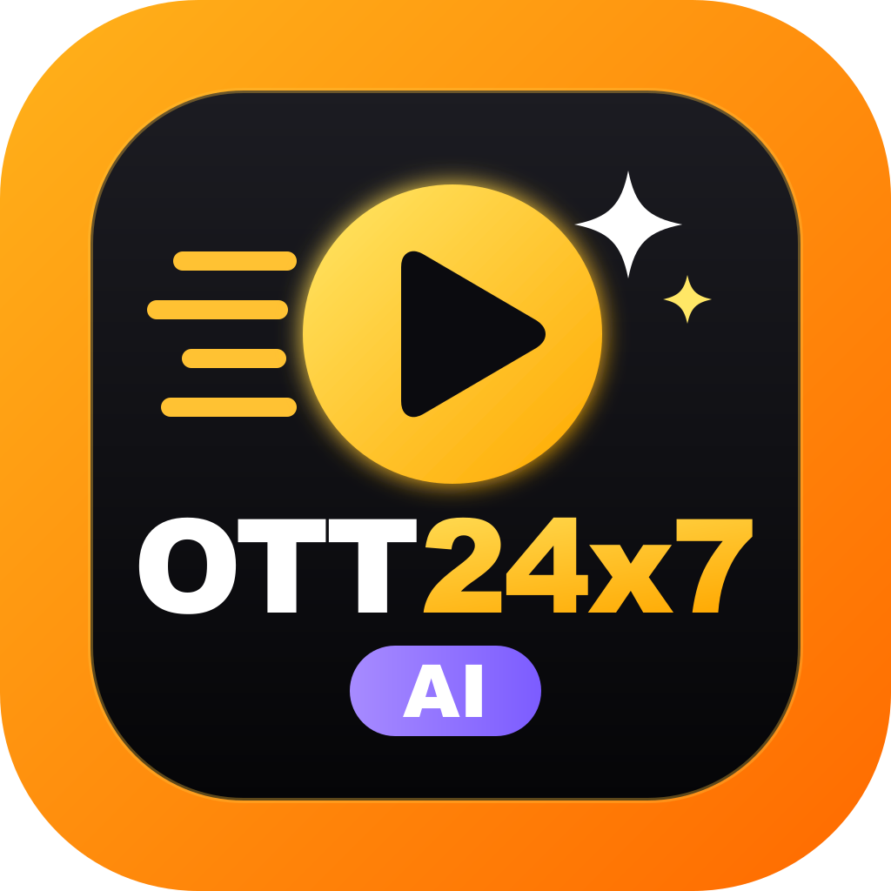

<h1 align="center">
  <br>
  OTT24x7 AI
</h1>

<p align="center"><b>All your AIs in one desktop app.</b> Ask once, compare every answer side by side, and get one combined final answer.</p>

<p align="center"><a href="https://ott24x7.com">ott24x7.com</a> · Free for Windows · Open source (AGPL-3.0)</p>

---

## Features

- **Compare:** one prompt goes to many AIs at once, with the answers side by side. Use 1–4 columns or a 2×2 grid, and **Focus mode** (`Ctrl+1…9`, `Esc` to go back).
- **Sign in, no API keys:** ChatGPT, Claude, Gemini, DeepSeek, Grok, Copilot and Perplexity run as web panels. Sign in once with your own account and the login is remembered.
- **Signed-in CLI columns:** if the Claude Code, Antigravity (`agy`) or Codex CLIs are installed and signed in, they appear as native columns with no key needed.
- **✦ Combine:** merges every answer into one final answer, using a signed-in CLI, a web panel or any model as the judge.
- **Image & Video Studio:** Generate (any image model), Gemini, Google Flow (Veo 3), ChatGPT Images and Microsoft Designer, plus a prompt helper.
- **Code:** coding chat, and "Open in Zed / VS Code / Cursor".
- **Attachments:** images, PDFs and **ZIP projects** (unpacked safely and sent as context).
- **Optional API keys:** OpenRouter (free models), HeyRoute, or any OpenAI-compatible / Anthropic endpoint, with **Fetch models** and **Test** buttons.
- **Per-site proxy:** route only one site (for example Perplexity) through a proxy while everything else stays direct.
- Light and dark mode, a collapsible sidebar, and 15 languages.

## Download

Get the Windows installer from [ott24x7.com](https://ott24x7.com) or this repository's **Releases** page.

The installer is not code-signed yet. If Windows SmartScreen appears, choose **More info → Run anyway**.

## Build from source

Requirements: Node.js ≥ 24.12 and pnpm 12 (`corepack enable`).

```bash
pnpm install
pnpm dev          # run in development
pnpm build:win    # build the Windows installer into dist/
```

## Privacy

There are no accounts, telemetry or update servers. Your chats, settings and logins stay on your PC. The web panels talk directly to each AI's own website.

## License

OTT24x7 AI is free software under the **GNU Affero General Public License v3.0**. See [LICENSE](LICENSE) and [NOTICE](NOTICE).
